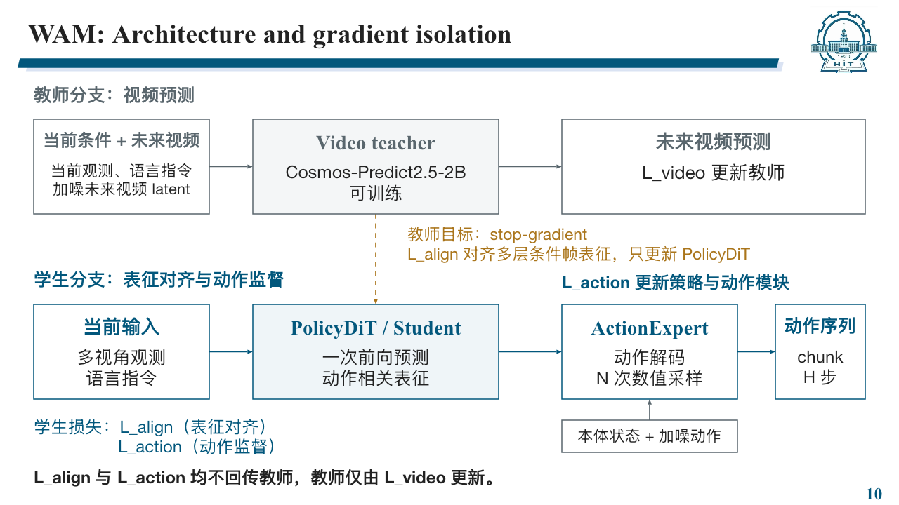
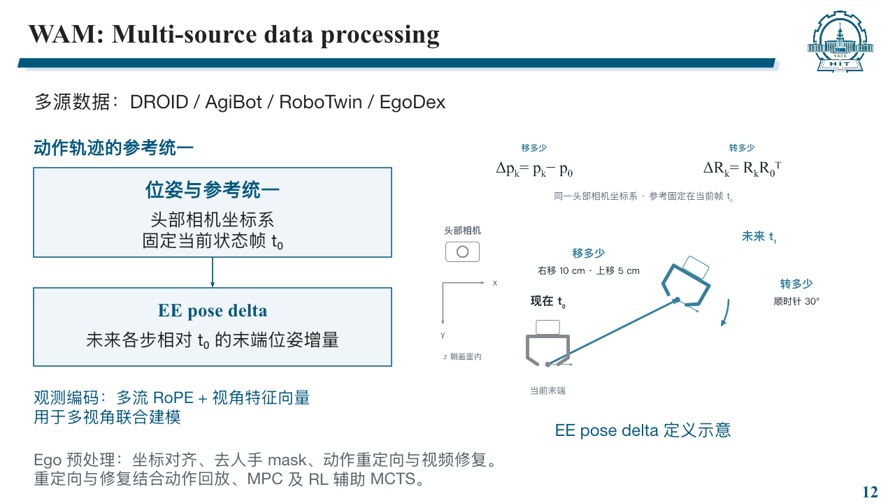
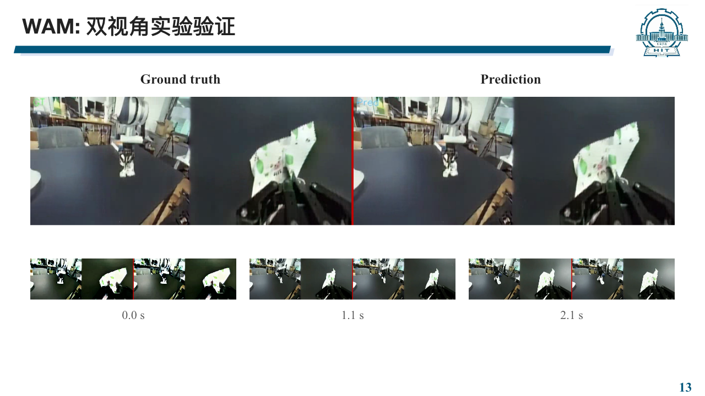
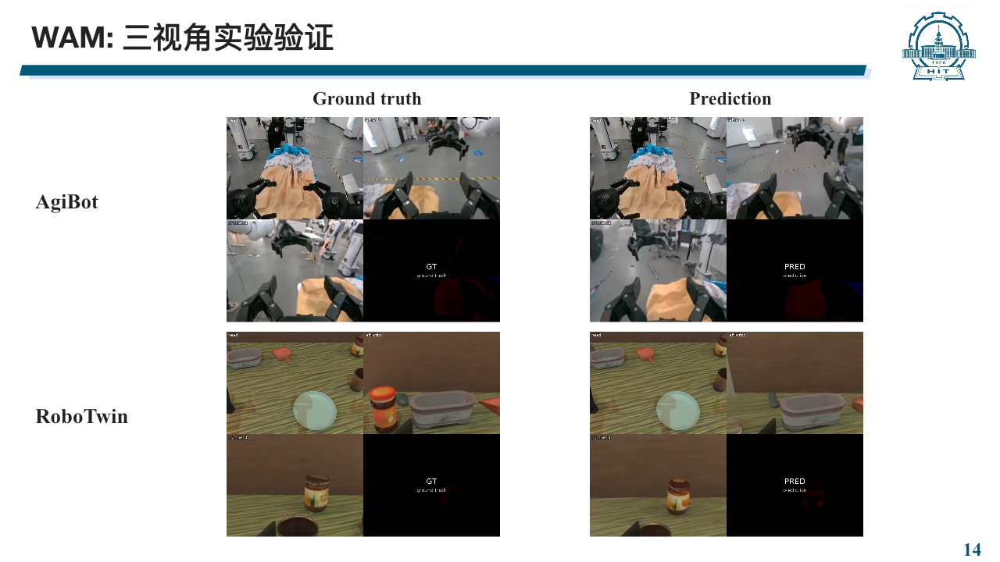

# WAM · 视频教师、策略表征与动作预测

智源人工智能研究院（BAAI）· 2026.04–2026.07.28

个人工作：框架设计与实现、异构动作表征统一、Ego 数据处理及实验验证。

[返回个人主页](../README.md) · [项目演示画廊](https://github.com/guoyue0412/reading-journal-sites/blob/main/projects.md)

## 教师–学生架构与梯度隔离

训练时，视频教师接收当前观测、语言指令和加噪的未来视频 latent，通过视频预测学习动态信息。PolicyDiT 仅接收当前可获得的观测与语言条件，预测动作相关表征，再交给 ActionExpert 解码动作。

| 损失 | 监督对象 | 更新参数 |
|---|---|---|
| `L_video` | 未来视频预测 | 视频教师 |
| `L_align` | 多层条件帧表征对齐，教师目标侧使用 stop-gradient | PolicyDiT |
| `L_action` | 示范动作监督 | PolicyDiT 与 ActionExpert |

教师保持视频预测训练；`L_align` 与 `L_action` 均不回传教师。部署时移除教师的视频去噪路径，使用 PolicyDiT 一次前向生成表征，再由动作模块多步采样输出动作 chunk。

动作解码的采样次数 **N** 与输出序列长度 **H** 分别表示计算步数和动作时间步数。PolicyDiT 的一次表征前向不等于端到端单步推理。

### 与 DiT4DiT 公开基线的关系

DiT4DiT 的公开实现把视频隐藏特征送入动作分支前执行 `detach()`，使动作损失不会沿该特征路径更新 Video DiT。视频预测损失独立保留梯度，即使采用视频与动作联合损失，视频分支仍可更新。

对应官方代码版本 `66a6f3a`：[特征 detach](https://github.com/Mondo-Robotics/DiT4DiT/blob/66a6f3a12e2c8740157c1e478795952c040d31dd/DiT4DiT/model/modules/vlm/Cosmos25.py#L841-L847)、[调用时显式指定 detach=True](https://github.com/Mondo-Robotics/DiT4DiT/blob/66a6f3a12e2c8740157c1e478795952c040d31dd/DiT4DiT/model/modules/vlm/Cosmos25.py#L1056-L1077)、[联合损失与反向传播](https://github.com/Mondo-Robotics/DiT4DiT/blob/66a6f3a12e2c8740157c1e478795952c040d31dd/DiT4DiT/training/train.py#L504-L528)。上图 WAM 在此研究方向上采用独立的教师–学生表征对齐，不把 WAM 的 `L_align` 归入公开基线。

## 统一动作表示：EE pose delta

数据来自 DROID、AgiBot、RoboTwin 与 EgoDex。动作侧统一到头部相机坐标系，以当前状态帧 **t₀** 为固定参考，表示未来各步末端位置与朝向的变化。

在同一头部相机坐标系中，平移增量定义为 `Δpₖ = pₖ − p₀`，旋转增量定义为 `ΔRₖ = Rₖ R₀ᵀ`。未来各步都相对同一个 t₀ 计算。图中的厘米与角度用于解释定义。

观测侧采用多流 RoPE 与视角特征向量进行联合建模。Ego 数据处理包含坐标对齐、人手 mask 提取与去除，并结合动作回放、MPC 和 RL 辅助 MCTS 开展动作重定向与视频修复。

## 双视角实验验证

左侧为 Ground truth，右侧为 Prediction，每侧包含两路视角；下方展示 0.0 s、1.1 s 与 2.1 s 的对应片段，用于观察物体运动与跨视角事件一致性。

## 三视角实验验证

上排为 AgiBot，下排为 RoboTwin，左列为 Ground truth，右列为 Prediction。每个拼接画面包含三路相机，黑色格承载 GT / Pred 标签。

[AgiBot GT 视频](https://github.com/guoyue0412/reading-journal-sites/blob/main/assets/evidence/baai-wam/agibot_mobile_gt_2x2.mp4) · [AgiBot 预测视频](https://github.com/guoyue0412/reading-journal-sites/blob/main/assets/evidence/baai-wam/agibot_mobile_pred_2x2.mp4) · [RoboTwin GT 视频](https://github.com/guoyue0412/reading-journal-sites/blob/main/assets/evidence/baai-wam/robotwin_aloha_gt_2x2.mp4) · [RoboTwin 预测视频](https://github.com/guoyue0412/reading-journal-sites/blob/main/assets/evidence/baai-wam/robotwin_aloha_pred_2x2.mp4)

## 动作策略与垂域应用

WAM 在 Franka 平台完成 100 次 rollout，成功率约 80%；另通过新本体后训练学习曲线的坡度对比进行消融。上述视频对照展示预测结果，动作策略的成功率来自独立任务评测。

DiT4DiT 的主要应用是酒店服务：负责数据采集、模型训练与 OpenArm 真机部署，完成证件交互。OpenArms 双臂叠衣属于复现验证，视频收录于[演示画廊](https://github.com/guoyue0412/reading-journal-sites/blob/main/projects.md#baai--openarms-双臂叠衣dit4dit-跨本体后训练)。
